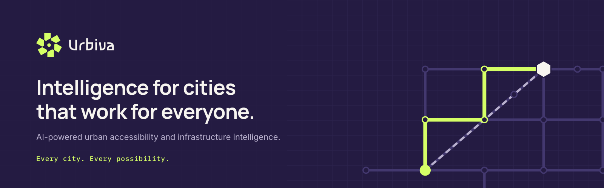
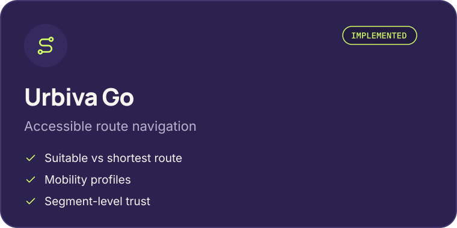
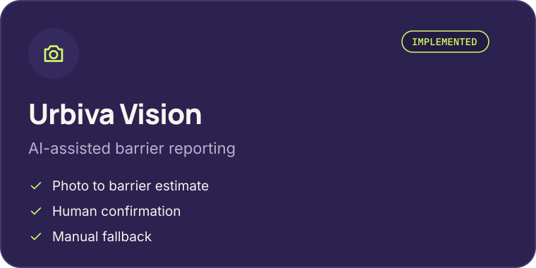
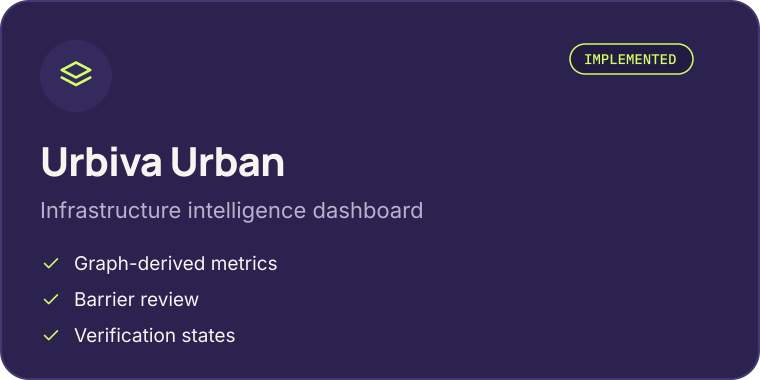
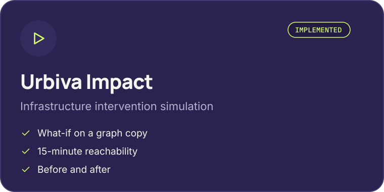
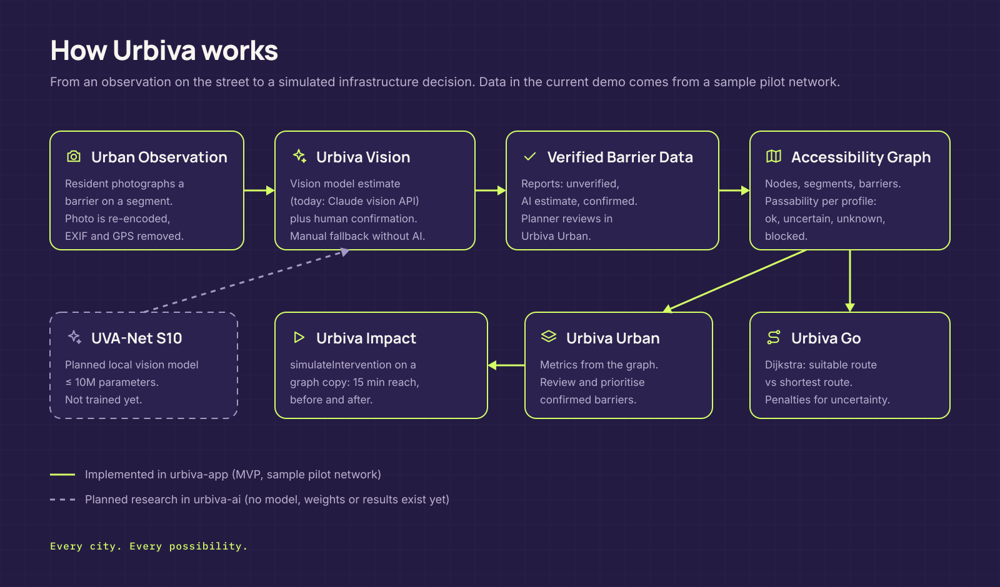

<picture>
  <source media="(prefers-color-scheme: light)" srcset="assets/urbiva-banner-light.png">
  
</picture>

<h3 align="center">Intelligence for cities that work for everyone.</h3>

AI-powered urban accessibility and infrastructure intelligence. <b>Every city. Every possibility.</b>

<picture>
  <source media="(prefers-color-scheme: light)" srcset="assets/divider-light.png">
  
</picture>

## Why Urbiva

The shortest route is not always a passable one. Stairs, high curbs, broken surfaces and blocked paths turn a short walk into a long or impossible one for wheelchair users, parents with strollers and older people. Cities rarely know where these barriers are, and planners rarely see which repair would help the most people.

Urbiva connects three things: what people observe on the street, a verified accessibility graph, and a simple way to measure the effect of removing a barrier.

## Four modules

<table>
  <tr>
    <td width="50%">
      <picture>
        <source media="(prefers-color-scheme: light)" srcset="assets/module-go-light.png">
        
      </picture>
    </td>
    <td width="50%">
      <picture>
        <source media="(prefers-color-scheme: light)" srcset="assets/module-vision-light.png">
        
      </picture>
    </td>
  </tr>
  <tr>
    <td width="50%">
      <picture>
        <source media="(prefers-color-scheme: light)" srcset="assets/module-urban-light.png">
        
      </picture>
    </td>
    <td width="50%">
      <picture>
        <source media="(prefers-color-scheme: light)" srcset="assets/module-impact-light.png">
        
      </picture>
    </td>
  </tr>
</table>

| Module | For | What it does |
| --- | --- | --- |
| **Urbiva Go** | Residents | Compares a suitable route with the shortest route for a mobility profile and says honestly what is not verified |
| **Urbiva Vision** | Residents | Turns a photo into a barrier report; AI gives an estimate, a person confirms it |
| **Urbiva Urban** | Planners | Shows segment states, barrier records and a review queue |
| **Urbiva Impact** | Planners | Recalculates 15-minute reachability on a copy of the graph after removing a barrier |

## How it fits together

<picture>
  <source media="(prefers-color-scheme: light)" srcset="assets/urbiva-architecture-light.png">
  
</picture>

## Where we are

| Area | Status |
| --- | --- |
| Hackathon MVP with all four modules and a guided demo | Implemented |
| Demo network "Pilot zona A" | Sample data, not a real city |
| Design system v1.0 | Design freeze |
| UVA-Net S10, a lightweight local vision model | Planned research, no model or results yet |
| Public deployment and real pilot data | Planned |

## Principles

- **Human confirmation.** AI output is an estimate until a person confirms it.
- **Honest data.** Unknown and unverified segments are shown as such, never hidden.
- **Privacy by default.** Photos are stripped of metadata and are not stored.
- **Measured impact.** Every number comes from the graph, with its assumptions shown.

<picture>
  <source media="(prefers-color-scheme: light)" srcset="assets/divider-light.png">
  
</picture>

Urbiva. Building accessible, human-centered cities with artificial intelligence.

